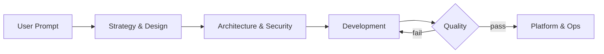

Back in February I wrote about [orchestrating AI agents with a pipeline pattern](). Five specialized personas, one tech lead orchestrator, a quality gate with a retry loop. It worked. I used it for months.

Then I hit the ceiling, tore it apart, and rebuilt it as a twelve-agent pipeline that runs multiple issues **concurrently**. That's now packaged as a Copilot CLI plugin: [jmassardo/agentic-sdlc](https://github.com/jmassardo/agentic-sdlc).

This post is the connective tissue between those two designs. Where the last one described a snapshot, this one describes the arc: one agent, then too many agents, then the orchestrator, then parallel pipelines. Each stage failed in a specific and instructive way, and the failures are more useful than the successes.

## Stage 1: One Agent to Rule Them All

The obvious starting point. One system prompt covering requirements, architecture, implementation, testing, and deployment. Ship it and see what happens.

What happened was uniform mediocrity. The prompt bloated. The agent lost focus mid-task. Context filled with instructions irrelevant to whatever it was currently doing. Ask it to write a feature and it would produce something that technically satisfied the request while quietly ignoring half the constraints buried on line 340 of its instructions.

**The lesson:** the same reason we don't ask one engineer to write the spec, design the schema, build the feature, write the tests, and configure CI is the reason a single agent underperforms. Specialization isn't bureaucracy. It's how you keep attention narrow enough to be useful.

## Stage 2: Twenty-Nine Personas (Yes, Really)

So I split. Then split again. `Test Engineer`, `Platform Ops`, `Work Breakdown Specialist`, `Sr. Developer`, and twenty-five more. If specialization is good, maximum specialization must be great, right?

Reader, it was not great.

I expected agents collaborating toward a solution. What I got was a simulation of a dysfunctional engineering org. The `Sr. Developer` refused work, citing incomplete requirements. The `Work Breakdown Specialist` scrambled requirements as competing opinions flowed back to the `Product Manager`. `Platform Ops` filed complaints about failures the `Test Engineer` should have caught.

Every trope we joke about on engineering Twitter, faithfully reproduced. Which makes sense. LLMs learn from how humans actually behave, and humans in over-fragmented orgs spend most of their energy on handoff friction.

**The lesson:** split only where there's a genuine, differentiated problem to solve. Splitting for its own sake manufactures coordination overhead, and agents will happily reenact the politics that come with it.

## Stage 3: The Orchestrator Pattern

Collapsing back down landed me on five personas plus a coordinator:



The `Tech Lead` orchestrator did no work itself. It accumulated context, managed handoffs, applied skip logic for small changes, and enforced a quality gate with up to three retry cycles before escalating to me.

This design got several things genuinely right, and all of them survived into the current version:

- **Explicit definitions of done.** Agents declare victory early unless you give them a checklist to execute.
- **Hard boundaries.** Every agent carries a "never bypass quality checks" section. No `# noqa`, no `@ts-ignore`, no lowering coverage thresholds. If a check fails, fix the code, not the rules.
- **Anti-patterns as first-class instructions.** Telling an agent what *not* to do turned out to be more effective than telling it what to do.
- **Context accumulation.** Stateless sub-agents need the orchestrator to carry forward the full picture, or you get five disconnected outputs stapled together.

I ran this for months on real work. It was a solid pattern. And then I ran into two problems it couldn't solve.

## Where the Orchestrator Pattern Broke

### Problem 1: The unit of work was too big

The orchestrator happily accepted requests like "add sharing to saved designs." It would run the pipeline, produce a spec, produce an architecture, and hand `Development` something large and underspecified.

That's where every failure mode people complain about with coding agents lives. Hallucinated APIs. Quiet scope creep. Tests written to pass rather than to verify. "Done" that isn't. Here's the part that took me embarrassingly long to internalize: **those failure modes scale with the size of what you hand over.**

Give an agent a vague epic and it will confidently invent the parts it doesn't understand, inside a diff too large to review carefully. Give the *same model* a precisely specified change to four named files with explicit acceptance criteria, and you get work you can actually verify. Reliability isn't purely a property of the model. It's a property of the clarity and size of the request.

### Problem 2: Everything was serial

One orchestrator, one pipeline, one unit of work at a time. Meanwhile I had a backlog of fifteen issues, most of which touched completely different files. The agents were sitting idle in sequence for no structural reason other than "that's how I wired it."

## Stage 4: Decomposition, Then Parallelism

The current design starts from a single principle: **aggressive decomposition before any autonomous coding happens.**

A human and a `Product Manager` agent break the idea down through research, stories, and epics into **atomic issues**. Each one is small enough for an agent to finish in a single sitting. Each declares its file scope, acceptance criteria, and definition of done. That decomposition isn't preparation for the real work. It *is* the work that makes everything downstream safe.

And here's the payoff that justifies the effort. Atomic issues produce small PRs. Small PRs touching disjoint files rarely conflict. Work that rarely conflicts can run **concurrently**.

That's the entire premise of the `Dispatcher`. If you can prove two issues don't overlap, you can run two full pipelines at once. Or six. Throughput stops being limited by how fast one agent works and becomes limited by how well the work was decomposed. Decompose better, scale wider.

Merge-conflict risk, normally the thing that punishes parallelism, gets designed out at the issue level instead of fought at the merge.

## The New Agents

Going parallel created problems the serial pattern never had, so five new roles showed up to handle them.

| Agent | Exists because |
|-------|----------------|
| **Product Manager** | Someone has to own decomposition. Research, epics as milestones, atomic issues, and a written implementation plan in every issue before dispatch. |
| **Dispatcher** | Someone has to own scheduling. Builds a dependency and file-conflict graph, batches issues into parallel-safe waves of 2 to 6, and asks for human approval before spawning them. |
| **Reviewer** | Six concurrent agents can hallucinate six APIs. Sits between Development and Quality and opens the definition of every referenced symbol to prove it exists. |
| **Standards & Consistency** | Six agents will invent six error-handling conventions and three HTTP clients. This one keeps N parallel implementations looking like one team wrote them. |
| **Integrator** | Quality only ever certified each branch in isolation. Merges in dependency order and re-runs the entire suite after every single merge. |
| **Retrospective** | Every change can be locally correct while the codebase still decays. Periodically scans for duplication, drift, and debt, then files atomic cleanup issues. |

The original five personas are all still there, doing roughly what they did before. `Tech Lead` got demoted, in a sense: it now orchestrates exactly one issue, and the `Dispatcher` runs several Tech Leads at once.

## The Reviewer Is My Favorite Addition

If you take one idea from this post, take this one.

`Development` hands off to `Reviewer`, not to `Quality`. Before a single test runs, the Reviewer reads the diff against the issue's implementation plan and:

- Confirms the change stayed inside its declared file list, so scope creep is caught while it's still one branch's problem
- **Opens the definition of every referenced import, function, attribute, endpoint, config key, and mock target** to prove it actually exists
- Traces every acceptance criterion to real code and a real test
- Scans for `/tmp` paths, TODOs, stubs, and weakened tests

That second bullet is the one that matters most. A test written by the same agent that hallucinated an API will cheerfully mock the API it hallucinated, and then pass. Tests do not catch hallucinations when the same model wrote both sides. Something has to actually go look.

Running this *before* Quality means test cycles are never spent on work that's already wrong.

## Speed Without Gates Is Just Faster Decay

Parallelism creates failure modes no individual pipeline can see. Two implementations of the same helper. Branches that each pass their own tests and break each other on merge. So every pipeline runs through Reviewer and Quality, consults Standards & Consistency, and reconciles through Integrator.

Two rules are non-negotiable across all twelve agents:

1. **The entire test suite must pass.** Not the changed files. Lint, type checks, unit, integration, E2E, coverage, and build, across the whole codebase. "Pre-existing" and "unrelated" failures still block completion. Enforced per branch by Quality and after every merge by Integrator.
2. **Never write to `/tmp` or system temp directories.** Use `mktemp -d`, `tempfile.mkdtemp()`, pytest's `tmp_path`, `fs.mkdtemp()`, or `$RUNNER_TEMP`.

That second one is enforced *mechanically*, not by prose. A `preToolUse` hook inspects shell commands and denies any that reference hardcoded temp paths. A sibling hook denies commands that look like they're about to commit a credential: private key headers, recognized provider key formats, high-entropy literals assigned to secret-shaped variables, `git add` of a real `.env` file.

Why mechanical? Because many agents committing fast is precisely the condition under which a secret slips into history, and a leaked credential is the one mistake a follow-up commit cannot fix. Rotation is the only remedy. So it gets blocked at the tool boundary rather than left for a reviewer to spot by eye.

## Humans Stay Where the Decisions Are Irreversible

This is emphatically not fire-and-forget. The boring parts are automated precisely so attention is available for the parts that matter. Two gates are hard requirements:

| Gate | Who asks | Why |
|------|----------|-----|
| **Before dispatching a wave** | `Dispatcher` | Spawning N concurrent pipelines is the most expensive, least reversible action in the system, taken on the strength of an automated safety analysis. You see the proposed issues, why they're judged parallel-safe, what got held back, and the estimated scope. |
| **Before merging to `main`** | `Integrator` | A green suite is necessary, not sufficient. Merging freely into the *integration* branch is the automated cross-feature testing loop. Putting N features onto the shared trunk is a human call. |

Everything in between runs unattended, but not unobserved. Every agent narrates its own work into the GitHub issue thread: start, handoff, block, defect, retry. You watch a dozen concurrent pipelines from the issue list rather than from twelve scrolling terminal transcripts. Both approvals are recorded in writing on the epic under a `needs-human` label, so they're auditable instead of buried in a chat log.

That detail sounds like process hygiene. In practice it's the thing that makes parallelism tolerable. Without it, "six agents are working" means "six windows I can't read."

## The Arc, Summarized

| Stage | Structure | What killed it |
|-------|-----------|----------------|
| One agent | Single bloated prompt | Mediocre at everything, no focus |
| 29 personas | Maximum specialization | Simulated org dysfunction, endless handoff friction |
| Orchestrator | 5 specialists + Tech Lead | Unit of work too large, strictly serial |
| Agentic SDLC | 12 agents, parallel waves | Current design. Ask me in six months. |

Notice the shape of the progression. Every stage was a correction to the previous stage's overcorrection. Too monolithic, then too fragmented, then well-structured but serial, then decomposed and parallel. That's not a straight line toward truth. It's the normal way you find the shape of a problem.

## What I'd Tell You to Steal

The plugin is opinionated and tuned to how I work. The underlying ideas are not tool-specific:

- **Decompose until the unit of work is boringly small.** This single change fixed more agent failure modes than any prompt improvement I've ever made.
- **Verify referenced symbols exist.** Don't rely on tests written by the same agent that wrote the code. "Probably exists" is not verification.
- **Gate on the entire suite.** Per-branch green plus per-merge green, or your parallel work will pass individually and fail collectively.
- **Enforce the unfixable mistakes mechanically.** Secrets and temp paths get hooks, not paragraphs.
- **Narrate everything into the issue tracker.** Concurrency without an audit trail is just chaos with better marketing.
- **Keep humans on the irreversible steps.** Two gates. Not twenty, and not zero.

## Try It

```shell
copilot plugin install jmassardo/agentic-sdlc
```

Then kick it off:

```
/new-idea users should be able to share saved designs with a public link
```

That routes into `Product Manager`, which researches, delegates story writing, creates a milestone and epic issue, breaks the epic into atomic issues, expands each with acceptance criteria and file-level notes, and hands the backlog to `Dispatcher`.

If you already have a well-specified issue, skip to `Tech Lead`. If you have an expanded backlog and just want it scheduled, start at `Dispatcher`. If you want to know how much drift has piled up, invoke `Retrospective` directly.

## Summary and Key Takeaways

- The path here ran one agent, then 29, then five plus an orchestrator, then twelve running in parallel. Each stage broke in a specific way that pointed at the next design.
- Over-specialization makes agents reenact org dysfunction. Split only where there's a real differentiated problem.
- The orchestrator pattern was solid but capped by two things: an oversized unit of work and strictly serial execution.
- Agent reliability scales with how small and well-specified the request is. Decomposition is the highest-leverage change available.
- Small atomic issues are what make horizontal scaling possible, because disjoint file scopes rarely conflict.
- Parallelism needs new gates: a Reviewer that verifies symbols exist, a Standards agent that keeps N implementations consistent, an Integrator that re-tests after every merge, and a Retrospective that pays down accumulated drift.
- Automate the boring parts so human attention lands on the two irreversible decisions: which wave gets dispatched, and what reaches `main`.
- Full implementation at [github.com/jmassardo/agentic-sdlc](https://github.com/jmassardo/agentic-sdlc). Fork it, gut it, make it yours.

---

*Building something similar, or think I got it wrong? I'd genuinely like to hear about it. Find me on [LinkedIn](https://www.linkedin.com/in/jenna-massardo/), [Bluesky](https://bsky.app/profile/jmassardo.bsky.social), or [GitHub](https://github.com/jmassardo).*
