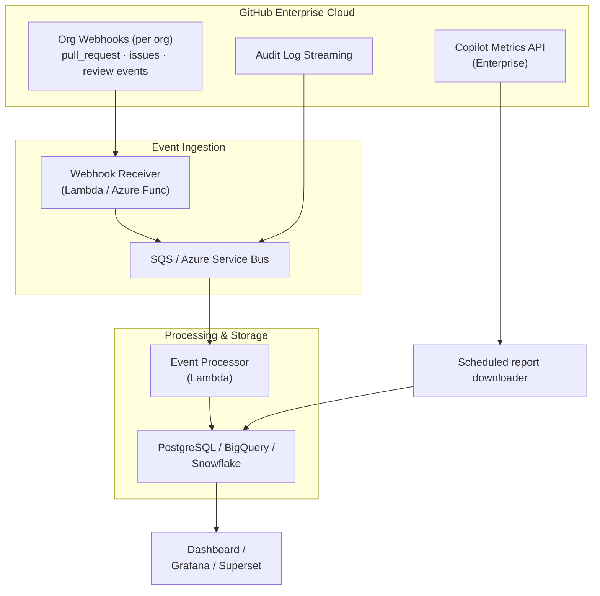

In Parts [1](/blog/2026/03/10/measuring-genai-effectiveness-data-collection/), [2](/blog/2026/03/10/measuring-genai-effectiveness-dashboard/), and [3](/blog/2026/03/10/measuring-genai-effectiveness-alerting/) we built a complete metrics collection, dashboard, and alerting system. It works great for a single org with a few dozen repos.

Now let's break it.

Imagine you're running this at a large enterprise. You have **100 organizations** on GitHub Enterprise Cloud, **100,000 repositories** across those orgs, and **15,000 Copilot seats**. Let's do some napkin math on what happens when you try to run our polling-based collectors at that scale.

## Why Polling Breaks

### The Math Problem

For PR metrics alone, each repo requires:
- 1 API call to list closed PRs
- 1 API call to list open PRs
- 1 API call per PR to fetch reviews

Assume a modest average of 10 PRs per repo per collection window:

```
100,000 repos x (2 + 10) API calls = 1,200,000 API calls
```

GitHub's [REST primary limit](https://docs.github.com/en/rest/using-the-rest-api/rate-limits-for-the-rest-api) is generally **5,000 requests per hour** for authenticated users. App installations on Enterprise Cloud organizations get 15,000; not every installation does. Secondary limits also apply. Even at the generous rate:

```
1,200,000 / 15,000 = 80 hours
```

Your "nightly" job would need **at least 3.3 days** under this single-budget assumption. PR detail calls and pagination make this lower-bound estimate worse. Multiple installations have separate budgets, but that doesn't make unrestricted concurrency a good plan.

### The Data Volume Problem

Even if you somehow solved the rate limit issue, storing raw JSON for 100k repos means gigabytes of data per collection run. JSON files in a git repo stop being cute around 100MB.

### The Blast Radius Problem

One bad token rotation, one API outage, one repo with 10,000 open PRs - and your entire collection pipeline fails or hangs. At small scale, you retry. At enterprise scale, you need resilience built into the architecture.

## The Paradigm Shift: Pull to Push

The fix isn't "poll faster." It's **stop doing full repository scans every night**. Keep bounded polling for daily Copilot reports and reconciliation; use events for PR and issue changes.

Instead of asking GitHub "what happened?" every night, we need GitHub to **tell us** when things happen. This is the shift from pull-based to push-based (event-driven) architecture.

Here's the enterprise reference architecture:



Let's break this down layer by layer.

## Layer 1: Event Sources

### Enterprise Copilot Metrics API

Good news: Copilot metrics **already aggregate at the enterprise level**:

```
GET /enterprises/{enterprise}/copilot/metrics/reports/enterprise-28-day/latest
```

**November 3, 2026 correction:** the legacy `/copilot/metrics` API sunset April 2. The [current report API](https://docs.github.com/en/rest/copilot/copilot-usage-metrics) returns signed `download_links` and reporting-window metadata. Download all NDJSON files, then normalize `day_totals`. This is one metadata request plus report downloads, not one inline metrics response.

Enterprise totals deduplicate users. Organization usage follows membership, so users can appear in multiple organizations; don't sum organization reports to reconstruct enterprise totals. Reports can lag two full UTC days. Enterprise history starts October 10, 2025, with up to one year accessible; organization history begins December 12, 2025.

For team analysis, [join daily user reports with same-day user-teams reports](https://docs.github.com/en/copilot/reference/copilot-usage-metrics/team-level-metrics). Sub-five-seat teams are excluded from the membership report, and overlapping memberships still require deduplication. Keep identities restricted, suppress small groups in shared dashboards, and never export individual activity as a developer performance ranking.

For seats, use the [user-management API](https://docs.github.com/en/rest/copilot/copilot-user-management), including enterprise seat endpoints where available and authorized. If you collect org seats, stagger them and deduplicate by stable user ID. Weekly collection may suit license reviews, but choose a cadence that fits your provisioning changes:

```python
# Stagger org-level seat collection across the week
# Org 1-15 on Monday, Org 16-30 on Tuesday, etc.
import hashlib

def get_collection_day(org_name: str) -> int:
    """Deterministically assign an org to a day of the week (0=Mon, 6=Sun)."""
    return int(hashlib.md5(org_name.encode()).hexdigest(), 16) % 7
```

### Organization Webhooks

Instead of polling for PRs and issues, configure **org-level webhooks** that fire on every event you care about:

```
POST https://your-webhook-receiver.example.com/github/events
```

Configure each org webhook to send:
- `pull_request` events (opened, closed, reopened; a merge is a `closed` action with `merged` set)
- `pull_request_review` events (submitted)
- `issues` events (opened, closed, reopened)
- `issue_comment` events (created)

At the org level, one webhook covers every repo in that org. 100 org webhooks replaces 100,000 repo-level API polling loops.

**Setting up an org webhook:**

```bash
# Using the GitHub CLI
gh api orgs/{org}/hooks \
  --method POST \
  -f name=web \
  -f 'config[url]=https://your-receiver.example.com/github/events' \
  -f 'config[content_type]=json' \
  -f "config[secret]=${WEBHOOK_SECRET}" \
  -f 'events[]=pull_request' \
  -f 'events[]=pull_request_review' \
  -f 'events[]=issues' \
  -f 'events[]=issue_comment' \
  -F active=true
```

### Audit Log Streaming

For enterprises that want even broader visibility, GHEC supports **audit log streaming** to:
- Amazon S3
- Azure Event Hubs
- Azure Blob Storage
- Datadog
- Google Cloud Storage
- Splunk

The [audit stream](https://docs.github.com/en/enterprise-cloud@latest/admin/monitoring-activity-in-your-enterprise/reviewing-audit-logs-for-your-enterprise/streaming-the-audit-log-for-your-enterprise) supplies administrative and security context. **It does not stream Copilot usage reports** or replace PR and issue webhooks. Use it where the extra governance context is useful.

Copilot agent-session activity streaming is also documented in public preview. Session events are a separate audit signal, not a substitute for daily adoption and completion metrics.

## Layer 2: Event Ingestion

### The Webhook Receiver

You need something to receive and queue webhook payloads. Keep this layer thin - validate the signature, drop the event on a queue, return 200. Don't process inline.

**AWS Lambda example ([API Gateway proxy integration](https://docs.aws.amazon.com/lambda/latest/dg/services-apigateway.html)):**

```python
import json
import hmac
import hashlib
import boto3
import base64
import os
from datetime import datetime, timezone

sqs = boto3.client('sqs')
QUEUE_URL = os.environ["QUEUE_URL"]  # Existing standard SQS queue
WEBHOOK_SECRET = os.environ["WEBHOOK_SECRET"]  # Runtime secret injection


def verify_signature(payload: bytes, signature: str) -> bool:
    expected = "sha256=" + hmac.new(
        WEBHOOK_SECRET.encode(), payload, hashlib.sha256
    ).hexdigest()
    return hmac.compare_digest(expected, signature)


def handler(event, context):
    raw = event.get("body") or ""
    body = base64.b64decode(raw) if event.get("isBase64Encoded") else raw.encode()
    headers = {k.lower(): v for k, v in (event.get("headers") or {}).items()}
    signature = headers.get("x-hub-signature-256", "")

    if not verify_signature(body, signature):
        return {"statusCode": 401, "body": "Invalid signature"}

    # Parse just enough to route the event
    try:
        payload = json.loads(body)
    except (ValueError, UnicodeDecodeError):
        return {"statusCode": 400, "body": "Invalid JSON"}
    event_type = headers.get("x-github-event", "unknown")

    # Drop onto SQS for async processing
    sqs.send_message(
        QueueUrl=QUEUE_URL,
        MessageBody=json.dumps({
            "event_type": event_type,
            "action": payload.get("action", ""),
            "payload": payload,
            "delivery_id": headers.get("x-github-delivery", ""),
            "received_at": datetime.now(timezone.utc).isoformat(),
        }),
    )

    return {"statusCode": 200, "body": "OK"}
```

This handler assumes API Gateway forwards the original request body unchanged. HMAC validates those bytes, not reserialized JSON. A queue failure must fail the request, not return success. Set short SDK timeouts so acknowledgement stays within GitHub's 10-second delivery window.

**Azure Functions equivalent (Python v1 programming model, using the [Service Bus Python SDK](https://learn.microsoft.com/en-us/azure/service-bus-messaging/service-bus-python-how-to-use-queues)):**

```python
import azure.functions as func
import json
import os
from azure.servicebus import ServiceBusClient, ServiceBusMessage

def main(req: func.HttpRequest) -> func.HttpResponse:
    # Reuse verify_signature and WEBHOOK_SECRET from the example above.
    if not verify_signature(req.get_body(), req.headers.get("x-hub-signature-256", "")):
        return func.HttpResponse("Invalid signature", status_code=401)

    event_type = req.headers.get("x-github-event", "unknown")
    payload = req.get_json()

    # Send to Service Bus queue
    with ServiceBusClient.from_connection_string(os.environ["SERVICE_BUS_CONNECTION"]) as client:
        sender = client.get_queue_sender(queue_name="github-events")
        sender.send_messages(
            ServiceBusMessage(body=json.dumps({
                "event_type": event_type,
                "action": payload.get("action", ""),
                "payload": payload,
            }))
        )
        sender.close()

    return func.HttpResponse("OK", status_code=200)
```

### Why a Queue?

Webhooks can burst. When a CI system merges 50 PRs in rapid succession, you'll get 50 webhook deliveries in seconds. A queue decouples ingestion from processing:

- **Burst buffering** - Durable queue acceptance reduces loss; it cannot recover undelivered webhooks
- **Retry built in** - Failed processing gets retried automatically
- **Backpressure** - Processors consume at their own pace
- **Dead letter queue** - Poison messages go somewhere you can inspect them

Enforce queue payload limits. Large webhook bodies need restricted object storage plus a queue pointer, not blind inline submission. [SQS message quotas](https://docs.aws.amazon.com/AWSSimpleQueueService/latest/SQSDeveloperGuide/quotas-messages.html) also limit retention; a queue is not your historical archive.

## Layer 3: Event Processing

A queue consumer reads events and writes derived metrics to your database:

```python
# Simplified event processor
from datetime import datetime

def process_pr_event(event: dict):
    action = event["action"]  # opened, closed, reopened
    pr = event["payload"]["pull_request"]
    repo = event["payload"]["repository"]["full_name"]

    if action in ("closed",) and pr.get("merged_at"):
        # PR was merged - calculate lifespan
        created = datetime.fromisoformat(pr["created_at"])
        merged = datetime.fromisoformat(pr["merged_at"])
        lifespan_hours = (merged - created).total_seconds() / 3600

        db.execute("""
            INSERT INTO pr_metrics (repo, pr_number, created_at, merged_at,
                                    lifespan_hours, additions, deletions)
            VALUES (%s, %s, %s, %s, %s, %s, %s)
            ON CONFLICT (repo, pr_number) DO UPDATE SET
                merged_at = EXCLUDED.merged_at,
                lifespan_hours = EXCLUDED.lifespan_hours
        """, (repo, pr["number"], created, merged, lifespan_hours,
              pr["additions"], pr["deletions"]))


def process_review_event(event: dict):
    review = event["payload"]["review"]
    pr = event["payload"]["pull_request"]
    repo = event["payload"]["repository"]["full_name"]

    # Record the review timestamp for TTFR calculation
    db.execute("""
        INSERT INTO pr_reviews (review_id, repo, pr_number, reviewer, state, submitted_at)
        VALUES (%s, %s, %s, %s, %s, %s)
        ON CONFLICT DO NOTHING
    """, (review["id"], repo, pr["number"], review["user"]["login"],
          review["state"], review["submitted_at"]))
```

These processor fragments assume a configured transactional database connection. Commit the write and delivery-id deduplication together, then acknowledge the queue message. Filter review actions and exclude bots and PR authors when computing human TTFR. Handle reordered events and reopening, not just the happy-path merge.

## Layer 4: Storage

At enterprise scale, you need a real database. Here are the practical options:

| Option | Best For | Cost Model |
|--------|----------|-----------|
| **PostgreSQL (RDS/Cloud SQL)** | Teams already running Postgres | Fixed instance cost |
| **BigQuery** | Heavy analytics, SQL-friendly teams | Per-query pricing |
| **Snowflake** | Enterprise data teams, joining with other data | Compute + storage |
| **ClickHouse** | Time-series heavy, self-hosted option | Free (self-hosted) |

A simple PostgreSQL schema covers everything:

```sql
CREATE TABLE pr_metrics (
    repo TEXT NOT NULL,
    pr_number INTEGER NOT NULL,
    author TEXT,
    created_at TIMESTAMPTZ NOT NULL,
    merged_at TIMESTAMPTZ,
    closed_at TIMESTAMPTZ,
    lifespan_hours NUMERIC,
    additions INTEGER,
    deletions INTEGER,
    first_review_at TIMESTAMPTZ,
    ttfr_hours NUMERIC,
    PRIMARY KEY (repo, pr_number)
);

CREATE TABLE issue_metrics (
    repo TEXT NOT NULL,
    issue_number INTEGER NOT NULL,
    author TEXT,
    created_at TIMESTAMPTZ NOT NULL,
    closed_at TIMESTAMPTZ,
    lifespan_hours NUMERIC,
    first_response_at TIMESTAMPTZ,
    ttfr_hours NUMERIC,
    is_stale BOOLEAN DEFAULT FALSE,
    PRIMARY KEY (repo, issue_number)
);

CREATE TABLE copilot_daily (
    date DATE NOT NULL,
    org TEXT NOT NULL,
    active_users INTEGER,
    acceptance_rate NUMERIC,
    total_suggestions INTEGER,
    total_acceptances INTEGER,
    user_initiated_interactions INTEGER,
    report_collected_at TIMESTAMPTZ,
    PRIMARY KEY (date, org)
);

CREATE TABLE pr_reviews (
    review_id BIGINT PRIMARY KEY,
    repo TEXT NOT NULL,
    pr_number INTEGER NOT NULL,
    reviewer TEXT,
    state TEXT,
    submitted_at TIMESTAMPTZ
);

-- Materialized view for dashboard queries
CREATE MATERIALIZED VIEW weekly_pr_stats AS
SELECT
    date_trunc('week', merged_at) AS week,
    COUNT(*) AS merged_count,
    PERCENTILE_CONT(0.5) WITHIN GROUP (ORDER BY lifespan_hours) AS median_lifespan,
    PERCENTILE_CONT(0.9) WITHIN GROUP (ORDER BY lifespan_hours) AS p90_lifespan,
    PERCENTILE_CONT(0.5) WITHIN GROUP (ORDER BY ttfr_hours) AS median_ttfr
FROM pr_metrics
WHERE merged_at IS NOT NULL
GROUP BY 1;
```

This is an application schema, not the API response. Map completion counts from the `code_completion` feature and preserve missing fields as null. Keep enterprise and org scopes separate. Materialized views require an explicit refresh; schedule `REFRESH MATERIALIZED VIEW weekly_pr_stats` after ingestion.

## GraphQL: The Middle Ground

If you're not ready for the full webhook architecture but polling is too slow, the **GitHub GraphQL API** offers a middle ground. You can fetch exactly the fields you need in fewer requests:

```graphql
query RecentPRs($org: String!, $repo: String!) {
  repository(owner: $org, name: $repo) {
    pullRequests(first: 50, states: [MERGED, CLOSED], orderBy: {field: UPDATED_AT, direction: DESC}) {
      nodes {
        number
        title
        createdAt
        mergedAt
        closedAt
        additions
        deletions
        reviews(first: 100) {
          nodes {
            submittedAt
            state
            author { login }
          }
          pageInfo { hasNextPage endCursor }
        }
        pageInfo { hasNextPage endCursor }
      }
    }
  }
}
```

This query can reduce REST round trips, but paginate **both** PRs and reviews. Select the earliest qualifying human review after fetching the relevant reviews; `first: 1` is not automatically first human review. [GraphQL limits](https://docs.github.com/en/graphql/overview/rate-limits-and-query-limits-for-the-graphql-api) use points and include node limits. Measure cost instead of assuming fewer requests always means less load.

**When to use each approach:**

| Scale | Approach |
|-------|----------|
| 1-5 orgs, < 100 repos | REST Polling (Parts 1-3) |
| 5-20 orgs, 100-1,000 repos | GraphQL Polling |
| 20+ orgs, 1,000+ repos | Webhooks + Event Queue |
| Enterprise (100+ orgs) | Webhooks + Queue + Database + Audit Log Streaming |

## Operational Considerations

### Webhook Reliability

GitHub [does not automatically redeliver failed webhooks](https://docs.github.com/en/webhooks/testing-and-troubleshooting-webhooks/redelivering-webhooks). Redelivery is available for the past three days. Build failure monitoring, authorized redelivery, and bounded REST reconciliation into the design:

- **Health checks** - Your receiver should have a `/health` endpoint for monitoring
- **Idempotency** - GitHub may redeliver events. Use `ON CONFLICT DO NOTHING` or `ON CONFLICT DO UPDATE` in your database writes
- **Dead letter queue** - Events that fail processing N times go to a DLQ for manual inspection
- **Monitoring** - Alert on DLQ depth, receiver errors, and event processing lag

### Missing Data Is an Operational Signal

If you expose aggregates to Prometheus, don't export a daily report snapshot as a monotonically increasing counter. Use gauges, retain the report day separately, and keep user IDs out of labels.

For one expected enterprise, define `copilot_report_day_timestamp_seconds{scope="enterprise",entity="example"}` as the UTC-midnight Unix timestamp of the newest report day successfully ingested. Leave it unchanged on failed collection; omit it if no report has ever succeeded.

This complete rule file checks stale reports and an absent series:

```yaml
# copilot.rules.yml
groups:
  - name: copilot-data-quality
    rules:
      - alert: CopilotReportStaleOrMissing
        expr: |
          (time() - copilot_report_day_timestamp_seconds{scope="enterprise",entity="example"} > 345600)
          or absent_over_time(copilot_report_day_timestamp_seconds{scope="enterprise",entity="example"}[30m])
        for: 30m
        labels:
          severity: warning
        annotations:
          summary: "Copilot report is missing or more than four days old"
      - alert: CopilotExporterDown
        expr: up{job="copilot-metrics"} == 0
        for: 10m
        labels:
          severity: warning
        annotations:
          summary: "Copilot metrics exporter cannot be scraped"
```

Load it with a minimal Prometheus configuration, replacing the target with your exporter:

```yaml
# prometheus.yml
global:
  scrape_interval: 1m
  evaluation_interval: 1m
rule_files:
  - copilot.rules.yml
scrape_configs:
  - job_name: copilot-metrics
    static_configs:
      - targets: ['localhost:9108']
```

Validate with `promtool check rules copilot.rules.yml` and `promtool check config prometheus.yml`. Add [Alertmanager routing](https://prometheus.io/docs/prometheus/latest/configuration/alerting_rules/) for notifications; loading a rule alone does not send one. Four days is a starter allowance for daily ingestion plus GitHub's processing lag, not a product SLA.

Use explicit expected scopes at scale; a global `absent()` query can't identify one missing team among hundreds. For Grafana-managed rules, configure and route [No Data and Error states](https://grafana.com/docs/grafana/latest/alerting/fundamentals/alert-rule-evaluation/nodata-and-error-states/) separately. Those settings do not configure Prometheus-managed rules.

### Multi-Org Management

Automating webhook setup across 100 orgs:

```python
import requests

ENTERPRISE_ORGS = get_all_enterprise_orgs()  # From enterprise admin API
WEBHOOK_CONFIG = {
    "url": "https://your-receiver.example.com/github/events",
    "content_type": "json",
    "secret": WEBHOOK_SECRET,
}

for org in ENTERPRISE_ORGS:
    resp = requests.post(
        f"https://api.github.com/orgs/{org}/hooks",
        headers=get_headers(),
        json={
            "name": "web",
            "config": WEBHOOK_CONFIG,
            "events": ["pull_request", "pull_request_review", "issues", "issue_comment"],
            "active": True,
        },
    )
    if resp.status_code == 201:
        print(f"  Created webhook for {org}")
    elif resp.status_code == 422:
        print(f"  Validation failed for {org}; inspect response and existing hooks")
    else:
        print(f"  Error for {org}: {resp.status_code}")
```

### Cost at Scale

These are illustrative planning allowances, **not current provider quotes or a measured deployment bill**. Recalculate for your region, event volume, retention, HA, logs, and database I/O:

| Component | Service | Estimated Monthly Cost |
|-----------|---------|----------------------|
| Webhook receiver | 2x Lambda / Azure Functions | $5-20 |
| Event queue | SQS / Service Bus | $10-50 |
| Event processor | Lambda / Azure Functions | $20-100 |
| Database | RDS Postgres (db.r6g.large) | $150-300 |
| Dashboard | Static site (S3 + CloudFront) | $1-5 |
| **Total** | | **$186-475/month** |

Compare the real operating bill with confirmed license savings and the value of improved visibility. Do not promise that this system pays for itself from unverified inactivity counts.

## Summary: The Evolution Path

Here's the journey we've taken across all four posts:

| Post | What You Get | Best For |
|------|-------------|----------|
| [Part 1: Collection](/blog/2026/03/10/measuring-genai-effectiveness-data-collection/) | Python scripts polling GitHub APIs | Getting started, POC |
| [Part 2: Dashboard](/blog/2026/03/10/measuring-genai-effectiveness-dashboard/) | Static GitHub Pages dashboard | Small-medium orgs |
| [Part 3: Alerting](/blog/2026/03/10/measuring-genai-effectiveness-alerting/) | Automated threshold-based alerts | Proactive monitoring |
| Part 4: Scaling (this post) | Event-driven architecture | Enterprise scale |

You don't need to jump straight to the enterprise pattern. Start with Parts 1-3. Fork [the companion repo](https://github.com/jmassardo/copilot-metrics-dashboard), set up your secrets, and let the nightly cron run. When you outgrow it, you'll know - the collection workflow will start timing out or hitting rate limits, and this post gives you the blueprint for what comes next.

The bottom line: measuring GenAI effectiveness is not about Copilot metrics in isolation. Correlate adoption with developer outcomes, then investigate comparable cohorts, work mix, rework, and developer feedback. More plumbing does not turn correlation into causation.

## Closing

*Building developer metrics at enterprise scale? I'd love to hear about your architecture. Find me on [GitHub](https://github.com/jmassardo), [LinkedIn](https://www.linkedin.com/in/jenna-massardo/), or [Bluesky](https://bsky.app/profile/jmassardo.bsky.social).*
