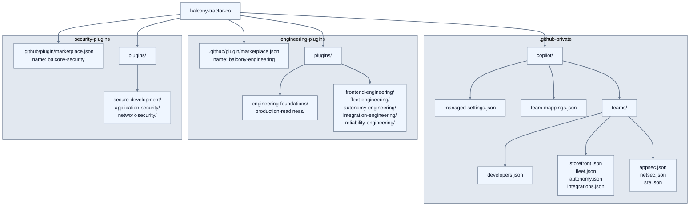
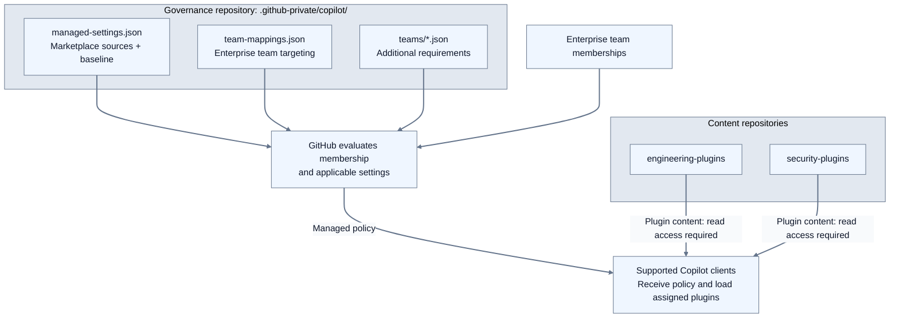

Balcony Tractor Co. builds connected tractors for condo owners. Its customers manage roughly nine square feet of farmland. Its engineers still manage firmware releases, payment services, network boundaries, and production incidents.

The tomatoes may be small. The operational requirements are not.

Seven teams now use GitHub Copilot, and each needs different capabilities. Sending everyone a marketplace URL and saying "install the right stuff" stopped working somewhere between the second onboarding checklist and the third forgotten update.

Imagine the next release: Storefront is adding an attachment subscription, Fleet is preparing a firmware rollout, and Integrations is connecting a new weather provider. AppSec wants consistent threat modeling. SRE wants rollback plans and useful telemetry before any of it reaches customers.

Each team has useful guidance, but it lives in different places. The goal isn't to give everyone every tool. It's to put the right guidance and workflows within reach without another scavenger hunt through the company's (most likely outdated) wiki.

**The better approach: centrally define the marketplaces, require a small common baseline, and assign additional plugins through enterprise teams.**

We'll build that configuration, follow engineers with overlapping memberships, and introduce a development channel without pretending team assignments can subtract requirements.

Balcony Tractor Co. is fictional. These are configuration examples based on official documentation reviewed on November 23, 2026, not results from a live enterprise deployment.

## TL;DR

- **Marketplaces make plugins available.** Managed `enabledPlugins` entries require or block individual plugins.
- **Keep content and deployment policy separate.** Publish plugins in marketplace repositories; govern assignments through the designated `.github-private` repository.
- **Team plugin assignments are additive.** Multiple memberships can accumulate requirements, not select one exclusive role.
- **Treat release channels as an explicit design decision.** A second marketplace identity avoids a same-name source conflict, but can introduce duplicate installations.
- **Verify the client and the behavior.** Policy delivery, marketplace refresh, plugin installation, and tool authentication are different checkpoints.

## Meet the Organization

Selling tractors to people without yards is a niche business. The engineering organization should look more familiar.

Four development teams own different parts of the product. Three shared service teams work across those boundaries. That distinction matters: a Fleet engineer needs firmware-specific help, but also consumes security guidance and production standards maintained elsewhere.

| Enterprise team slug | Responsibility | Specialized plugin |
| --- | --- | --- |
| `storefront` | Tractor sales, accessories, and subscriptions | `frontend-engineering` |
| `fleet` | Device registration, firmware releases, and telemetry | `fleet-engineering` |
| `autonomy` | Route planning, geofencing, and obstacle detection | `autonomy-engineering` |
| `integrations` | Weather services, smart-home connections, and partner APIs | `integration-engineering` |
| `appsec` | Secure development guidance and application security reviews | `application-security` |
| `netsec` | Network boundaries, connectivity, and network security reviews | `network-security` |
| `sre` | Reliability, observability, and incident response | `reliability-engineering` |

These are **enterprise teams**, not organization teams that happen to have matching names. The documented server-managed targeting mechanism uses enterprise team slugs.

We also want three shared packages:

- **`engineering-foundations`:** contribution guidance and common engineering workflows, required for every user covered by this example's enterprise policy.
- **`secure-development`:** AppSec-maintained skills for threat modeling and secure code review, required for the four development teams and AppSec.
- **`production-readiness`:** SRE-maintained release readiness and observability guidance, required for the development teams and SRE.

**Ownership is not assignment.** AppSec can maintain a plugin used by developers without giving everyone AppSec's specialist workflows. SRE can publish readiness guidance without distributing its entire incident investigation toolkit.

For example, the shared readiness plugin might help a developer check service dashboards, alert ownership, and release recovery steps. SRE's specialist package could add incident timeline and investigation workflows. Both support reliability, but they serve different tasks and audiences.

These packages support engineering work. They do not replace human security review, production approval, or safety validation for physical equipment.

## Know What You're Actually Distributing

A **plugin** bundles related Copilot customizations into a package you can distribute, install, and update together. For example, AppSec's `secure-development` plugin could include a threat-modeling skill, a security review agent, and MCP configuration for an approved security tool. The supported components depend on the client.

A **marketplace** is the catalog that helps clients discover those packages and locate their files. Its `marketplace.json` describes the available plugins and their sources, which can point to directories in the marketplace repository or to other supported locations. Think of the plugin as the toolbox and the marketplace as the catalog, not the tools themselves.

To identify a particular plugin, configuration combines its name with the name of the marketplace that supplies it:

```text
secure-development@balcony-security
```

That's plugin `secure-development` from marketplace `balcony-security`. The marketplace name comes from the catalog's `name`, not its GitHub repository name.

The portable Agent Plugins format defines components such as skills and root-level MCP configuration. Copilot-specific components can live under `com.github.copilot/`, and component support varies by surface. **A plugin installing successfully does not prove every component works everywhere.** See the [plugin and marketplace reference][plugin-reference].

Four states matter:

| Configuration | Meaning |
| --- | --- |
| Marketplace in `extraKnownMarketplaces` | Makes its catalog available; does not require every plugin |
| Plugin set to `true` in managed `enabledPlugins` | Requires it enabled, with automatic installation behavior |
| Plugin set to `false` in managed `enabledPlugins` | Requires it disabled |
| Plugin omitted from managed `enabledPlugins` | No requirement from that entry; voluntary installation may remain possible |

Managed plugin decisions override repository defaults and user preferences. They are **requirements, not optional suggestions**. For optional project defaults, the separate mechanism is `.github/copilot/settings.json`, subject to managed policy. See [managing marketplaces and plugins][manage-plugins] and the [`enabledPlugins` reference][enabled-plugins].

At Balcony Tractor Co., a frontend package can be available to everyone without being required for NetSec. Conversely, if secure development guidance is part of the development baseline, publishing it in a catalog isn't enough. We need an explicit assignment.

### Check the Client Before Designing the Rollout

As reviewed on November 23, 2026, the [key-specific support table][managed-reference] lists both `enabledPlugins` and `extraKnownMarketplaces` as supported in Copilot CLI, VS Code, the GitHub Copilot app, JetBrains IDEs, and GitHub Actions-backed Copilot cloud sessions. It lists both as **unsupported in cloud sandbox sessions**.

Those two rows do not carry minimum-version footnotes in the reviewed reference. That is not a guarantee for every old client build, plugin component, or other policy key. Check the current table and its footnotes against the exact clients and session types you deploy.

## Separate Content from Governance

We'll use the fictional GitHub organization `balcony-tractor-co`. Replace it with your own organization; these repository names are illustrative.

Our design separates two decisions: **what a plugin does** and **who must receive it**. Engineering and security maintain their content in marketplace repositories. The governance repository records the rollout policy. A change to a review skill and a change requiring that skill across four teams deserve different review conversations.

### Repository Layout

Here's how we'll organize the three repositories. `.github-private` holds the enterprise baseline, team mappings, and assignment files. The engineering and security repositories each contain a marketplace catalog and the plugin packages it lists.



### From Policy to Plugins

GitHub evaluates the governance settings against each user's enterprise team memberships to determine the applicable policy. Supported clients receive that policy and retrieve the assigned plugins from the content repositories. These are separate paths: receiving a requirement does not grant access to the files needed to fulfill it.



This walkthrough assumes the catalogs and named plugins already exist and work in your target clients. It covers deployment policy, not complete plugin authoring. Start with GitHub's [marketplace publishing guide][publish-marketplace] for catalog and manifest setup.

**Governance access and content access are different.** Enterprise policy can apply without the user reading `.github-private`. Installing a private plugin still requires access to the marketplace and relevant plugin repositories, plus client sign-in. Organization membership alone does not grant private repository access.

If catalog entries point to other repositories, check those permissions and source refs too. A policy naming a repository is not an access grant. See [governance repository setup][governance-repo] and [marketplace access requirements][publish-marketplace].

## Step 1: Select the Governance Source

Creating a repository with the right name is only half the setup:

1. Choose an organization in your enterprise to own `.github-private`.
2. Create that repository using the documented template or the required structure.
3. Open the enterprise's **AI controls > Agents > Configuration source** and select the owning organization.
4. Protect policy changes with review requirements and repository rulesets.
5. Put the configuration on the governance repository's **default branch**.

For this example, we'd ask plugin owners to review the content and the people responsible for enterprise Copilot governance to review assignment changes. That keeps a routine skill improvement separate from the decision to require another package for hundreds of developers.

The [official setup instructions][governance-repo] cover repository visibility and selecting the source. Settings apply to users covered by the enterprise's Copilot licensing on supported clients, not every account that can discover a catalog.

For a dedicated Copilot Business enterprise without organizations, follow the [additional setup guidance][copilot-only] rather than assuming this organization-based example transfers unchanged.

## Step 2: Define Marketplaces and the Common Baseline

In `copilot/managed-settings.json`:

```json
{
  "extraKnownMarketplaces": {
    "balcony-engineering": {
      "source": {
        "source": "github",
        "repo": "balcony-tractor-co/engineering-plugins",
        "ref": "main"
      }
    },
    "balcony-security": {
      "source": {
        "source": "github",
        "repo": "balcony-tractor-co/security-plugins",
        "ref": "main"
      }
    }
  },
  "enabledPlugins": {
    "engineering-foundations@balcony-engineering": true
  }
}
```

The two catalog names must match the marketplace keys. Both sources are available centrally, but only `engineering-foundations` is required enterprise-wide.

Keep that baseline small. We put foundations here because the example deliberately requires it for every covered user, including people outside the seven teams. Development-specific tools belong in team assignments, not in the baseline simply because most current users happen to be developers.

`ref` selects a branch, tag, or commit SHA. Do not write `engineering-plugins@develop` in `repo`: that field uses `OWNER/REPO`. The `@` in a plugin identifier separates plugin and marketplace names, not Git branches. See the [marketplace settings schema][marketplace-settings].

There is deliberately **no `overridable` wrapper** here. We'll centralize marketplace definitions rather than let each team independently replace them.

## Step 3: Map Enterprise Teams to Settings Files

In `copilot/team-mappings.json`:

```json
{
  "developers.json": ["storefront", "fleet", "autonomy", "integrations"],
  "storefront.json": ["storefront"],
  "fleet.json": ["fleet"],
  "autonomy.json": ["autonomy"],
  "integrations.json": ["integrations"],
  "appsec.json": ["appsec"],
  "netsec.json": ["netsec"],
  "sre.json": ["sre"]
}
```

The mapping runs **from filename to an array of enterprise team slugs**. Files live under `copilot/teams/`.

The shared developer file applies to four teams. Each development team also has its own specialist file. That lets us maintain common assignments once without inventing another organizational hierarchy.

Think about Maya joining Storefront. Her membership matches both `developers.json` and `storefront.json`: one describes common development requirements, the other supplies her team's specialization. `developers.json` is a reusable configuration file, not another team Maya must join.

According to the [enterprise team settings documentation][team-settings], `enabledPlugins` is additive and does not need an `overridable` wrapper. Enterprise baseline requirements remain in effect; team files add assignments.

## Step 4: Assign Shared and Specialized Plugins

First, `copilot/teams/developers.json`:

```json
{
  "enabledPlugins": {
    "secure-development@balcony-security": true,
    "production-readiness@balcony-engineering": true
  }
}
```

The shared file answers "what should every development team receive?" The next four files answer "what is different about this team's work?"

Storefront's package might guide accessible UI reviews. Fleet's could walk through firmware release checks, while Autonomy's could help prepare simulation test plans. Integrations gets partner API and webhook review workflows. Those are proposed package responsibilities, not built-in Copilot features.

The assignments stay intentionally simple:

`copilot/teams/storefront.json`:

```json
{
  "enabledPlugins": {
    "frontend-engineering@balcony-engineering": true
  }
}
```

`copilot/teams/fleet.json`:

```json
{
  "enabledPlugins": {
    "fleet-engineering@balcony-engineering": true
  }
}
```

`copilot/teams/autonomy.json`:

```json
{
  "enabledPlugins": {
    "autonomy-engineering@balcony-engineering": true
  }
}
```

`copilot/teams/integrations.json`:

```json
{
  "enabledPlugins": {
    "integration-engineering@balcony-engineering": true
  }
}
```

Finally, the shared service teams get packages for their own responsibilities. AppSec retains the secure development guidance it maintains and adds specialist assessment workflows. NetSec gets network review capabilities. SRE receives both the shared readiness guidance and its deeper reliability toolkit.

We are not copying every security and operations tool to every developer. Useful shared guidance travels broadly; specialist packages follow the people who need them.

`copilot/teams/appsec.json`:

```json
{
  "enabledPlugins": {
    "secure-development@balcony-security": true,
    "application-security@balcony-security": true
  }
}
```

`copilot/teams/netsec.json`:

```json
{
  "enabledPlugins": {
    "network-security@balcony-security": true
  }
}
```

`copilot/teams/sre.json`:

```json
{
  "enabledPlugins": {
    "production-readiness@balcony-engineering": true,
    "reliability-engineering@balcony-engineering": true
  }
}
```

All seven teams receive the foundations baseline. The additional assignments are:

| Team | Additional required plugins |
| --- | --- |
| Storefront | Frontend engineering, secure development, production readiness |
| Fleet | Fleet engineering, secure development, production readiness |
| Autonomy | Autonomy engineering, secure development, production readiness |
| Integrations | Integration engineering, secure development, production readiness |
| AppSec | Secure development, application security |
| NetSec | Network security |
| SRE | Production readiness, reliability engineering |

Nobody needs to copy the marketplace sources into these eight files.

## What Happens When People Belong to Multiple Teams?

Real organizations don't fit neatly into one team per person. Jordan works on Fleet and participates in AppSec reviews. Sam spans reliability and network operations. We want those memberships to provide useful capabilities without maintaining a bespoke configuration for each person.

Here's what the assignments mean for three engineers:

| Engineer | Enterprise memberships | Expected required plugins, including baseline |
| --- | --- | --- |
| Maya | Storefront | Foundations, frontend engineering, secure development, production readiness |
| Jordan | Fleet and AppSec | Foundations, fleet engineering, secure development, production readiness, application security |
| Sam | SRE and NetSec | Foundations, production readiness, reliability engineering, network security |

Jordan's two assignments to `secure-development@balcony-security` name the same identifier, not two release channels. Sam receives requirements from two marketplaces.

In daily work, Maya could use the frontend package to review an attachment checkout screen, then use shared readiness guidance before release. Jordan could combine firmware-specific checks with AppSec's assessment workflow. Sam's incident investigation might need both reliability context and network diagnostics.

That's the reason to compose assignments around work rather than force every engineer into one exclusive role. The plugin supplies guidance or tool configuration; existing permissions still determine what systems each person can access.

A covered user outside all seven mapped teams still receives foundations because it is in the enterprise baseline. Their shorter assignment list does not block voluntary plugins from available marketplaces.

These are **configuration-derived expectations** from the documented additive model, not observations from deployed clients. See [enterprise team settings][team-settings].

Keep the example free of contradictory decisions. If one matching file sets a plugin to `true` and another sets it to `false`, don't invent a winner. Resolve the design conflict or verify that exact behavior before relying on it.

## Now Jordan Wants to Test the Next AppSec Release

AppSec has revised its assessment workflow, and Jordan volunteers to try it against a representative Fleet change before wider adoption. The goal is narrow: test the new AppSec package while keeping ordinary engineering tools stable.

This is where "just add another team" needs more thought. **Testing one plugin and switching an entire marketplace are different rollout decisions.**

### Recommended for Independent Channels: Distinct Identities

We can register a development marketplace alongside stable:

| Marketplace identity | Repository | Ref | Catalog `name` at that ref |
| --- | --- | --- | --- |
| `balcony-security` | `balcony-tractor-co/security-plugins` | `main` | `balcony-security` |
| `balcony-security-develop` | `balcony-tractor-co/security-plugins` | `develop` | `balcony-security-develop` |

Add this entry **inside the existing** `extraKnownMarketplaces` map, preserving the stable engineering and security entries:

```json
{
  "balcony-security-develop": {
    "source": {
      "source": "github",
      "repo": "balcony-tractor-co/security-plugins",
      "ref": "develop"
    }
  }
}
```

The development branch's catalog must advertise `balcony-security-develop`. A second settings key alone does not rename a catalog. These identity rules come from the [marketplace management guide][manage-plugins] and [shared reference][plugin-reference].

A tester file could then require `application-security@balcony-security-develop`.

**But Jordan already receives `application-security@balcony-security` through AppSec.** The extra assignment can give Jordan both packages, not replace stable with development. Different identifiers avoid one source-identity conflict; they do not prevent duplicate skills, commands, hooks, or MCP server names.

For an exclusive-channel rollout, our recommendation is to move that plugin's stable assignment out of the general AppSec file. Assign it through a dedicated stable cohort, with a separate development cohort for testers. Keep those cohorts mutually exclusive **for this plugin**, and ensure no other matching file or baseline requires the other channel.

Jordan remains an AppSec team member and keeps its other requirements. We change deployment targeting, not the person's job.

Treat those deployment cohorts as release management, with an owner and a membership review process. Otherwise, a temporary tester assignment has a remarkable ability to become permanent organizational archaeology.

### Alternative: Override One Marketplace Source

A coordinated tester cohort can instead replace the stable source for the same marketplace identity.

The enterprise must first wrap the **complete marketplace map** in `overridable`. A matching team file then supplies the replacement map, using `ref: "develop"` for the security source. Keep that branch's catalog name `balcony-security` in this design.

The [documented replacement behavior][marketplace-settings] has important consequences:

- Include every baseline marketplace the team should retain, including engineering.
- Switching the security marketplace source can affect other installed plugins from it, not just AppSec's specialist plugin.
- Check any `strictKnownMarketplaces` restrictions against the selected source.
- Inspect externally referenced plugin sources; selecting a catalog branch does not prove all plugin files follow it.
- If overlapping teams define the same marketplace at different refs, do not assume an undocumented tie-breaker.

**My recommendation for independently maintained channels is distinct identities plus deliberate targeting.** Source overrides remain useful when the whole marketplace is intentionally tested as a unit.

Neither design promises immediate replacement of already-installed content.

## Updates, Promotion, and Rollback Are Separate Jobs

The optional `autoUpdate` property sits alongside `source` in each marketplace entry:

```json
{
  "source": {
    "source": "github",
    "repo": "balcony-tractor-co/engineering-plugins",
    "ref": "main"
  },
  "autoUpdate": true
}
```

Under the [documented semantics][marketplace-settings], `true` requires periodic marketplace refresh and updates of installed plugins from it. `false` requires automatic updates disabled. Omitting it leaves client defaults or user-configured behavior. Users cannot override a managed value.

Our baseline example omits it deliberately. Choose the update policy after testing the intended release process, not because a sample silently chose for you.

For Balcony Tractor Co., a useful pilot would ask Jordan to exercise the revised assessment against a representative change with a known review checklist. Can Jordan find and run the intended workflow? Does it request the expected context? Do any configured tools authenticate correctly?

Those observations are more useful than "the marketplace refreshed." They tell us whether the release is ready to promote, not just whether a catalog can be retrieved.

A practical promotion process:

1. Review and test changes in development.
2. Validate with a small, deliberately assigned cohort.
3. Promote reviewed content to the stable source, preserving the stable catalog identity.
4. Confirm the effective source and actual loaded behavior.
5. Retain a known-good reference and a tested recovery procedure.

Tags or commit SHAs improve source reproducibility. **Changing a ref backward is not proof every client automatically downgrades.** Test cache and version behavior.

Likewise, removing a `true` entry removes that requirement; do not assume it uninstalls existing files. A managed `false` requires disablement, which is a different operation.

The tractor may reverse on command. Your plugin rollout deserves its own test.

## Validate the Rollout, Not Just the JSON

GitHub validates the selected governance repository's baseline, mappings, and referenced team files. Review issues under **AI controls > Agents > Copilot settings validation**. See [validation and client refresh guidance][get-started].

Configuration validation is the first checkpoint, not the finish line. A valid assignment can still reference content a particular user cannot read, or deliver a package whose workflow hasn't been tested in that user's client.

Then test representative accounts:

| Case | What to verify |
| --- | --- |
| Maya, Storefront only | Baseline plus shared developer and frontend packages |
| Jordan, Fleet and AppSec | Both team assignments, with shared identifiers resolving consistently |
| Sam, SRE and NetSec | Both marketplace sources resolve and assigned capabilities load |
| No mapped membership | Foundations remains required; no team-specific requirement |
| Private content access missing | Policy does not magically grant repository access |
| Development tester | Effective marketplace identity, ref, and loaded content match the intended channel |
| Requirement removed or ref reverted | Actual retained installation and version behavior match the recovery plan |

For server-managed delivery, GitHub says settings normally arrive within about an hour; restarting the client or signing in again triggers an immediate policy refresh. **Policy refresh is not the same event as marketplace refresh or plugin update.**

Use a task with a recognizable result during the pilot. For Maya, that could mean asking Copilot to use the package's readiness skill against a sample release plan with a deliberately missing rollback step. Check that the intended skill ran and surfaced the omission, rather than accepting a plausible generic answer.

Record the client version, team memberships, intended source ref, and observed plugin behavior. That gives you something concrete to compare when the same setup works for Jordan but fails for Maya.

If something fails, check in this order:

1. Selected governance organization, default branch, and exact file paths.
2. Settings validation, enterprise team slugs, and membership.
3. Client version and key-specific session support.
4. Sign-in, enterprise Copilot entitlement, and billing selection if multiple entities provide access.
5. Repository permissions, catalog names, and plugin identifiers.
6. Replacement maps, source restrictions, and other active managed policies.
7. Actual skill or tool execution, including required service authentication.

Seeing a plugin in a catalog is not proof it installed. Seeing its tool name is not proof the tool can authenticate.

## Keep the Governance Boundaries Clear

Protect marketplace release changes as well as policy changes. Plugin authors should be able to propose improvements without automatically gaining authority to change enterprise deployment requirements.

An AppSec plugin change might alter review guidance or which external tool a workflow uses. A governance change might distribute that package to every development team. Both deserve review, but the second decision expands the audience and potential impact of the first.

For tighter source controls, `strictKnownMarketplaces` restricts marketplace sources and also disables built-in marketplaces. It does not certify plugin safety or, by itself, prohibit standalone customizations.

`strictPluginOnlyCustomization` is a separate optional policy for selected customization categories, with its own client and session semantics. Consult the [management guide][manage-plugins] before adding it; this walkthrough does not enable either restriction.

Plugin-provided MCP configuration also does not host a remote service, grant access, remove authentication, or override a policy disabling MCP. Keep credentials out of committed configuration.

Finally, this is a **server-managed** design. MDM can target device groups, and file-based delivery is another option, but enterprise team mappings are not a portable targeting mechanism for those methods. Native MDM uses OS-managed string values, not simply this nested JSON file. See [deployment methods and precedence][deployment].

## Summary and Key Takeaways

Balcony Tractor Co. can keep its product tiny without making its tooling strategy improvised.

Start with one reviewed baseline, centrally defined marketplaces, and explicit team assignments. Share files where requirements genuinely match. Separate plugin ownership from deployment authority.

Before broad rollout:

- [ ] Select the enterprise governance source, not just the repository name.
- [ ] Verify marketplace names, repository access, and supported clients.
- [ ] Review assignments for all seven teams and overlapping memberships.
- [ ] Make stable/development targeting explicit, including duplicate-package risks.
- [ ] Test policy delivery, plugin behavior, updates, and recovery separately.

**Treat plugins as shared agent infrastructure.** Make the useful path easy, the required path clear, and the recovery path something you've actually tested.

Nine square feet of tomatoes should not require seven onboarding documents.

---

*Rolling out Copilot plugins across your organization? I'd love to hear what's working and where team targeting gets complicated. Reach out on [LinkedIn](https://www.linkedin.com/in/jenna-massardo/), [Bluesky](https://bsky.app/profile/jmassardo.bsky.social), or [GitHub](https://github.com/jmassardo).*

[plugin-reference]: https://docs.github.com/en/enterprise-cloud@latest/copilot/reference/plugin-and-marketplace-reference
[manage-plugins]: https://docs.github.com/en/enterprise-cloud@latest/copilot/how-tos/administer-copilot/manage-for-enterprise/use-managed-settings/manage-plugin-marketplaces-and-plugins
[enabled-plugins]: https://docs.github.com/en/enterprise-cloud@latest/copilot/reference/enterprise-administrators/enterprise-managed-settings#enabledplugins
[managed-reference]: https://docs.github.com/en/enterprise-cloud@latest/copilot/reference/enterprise-administrators/enterprise-managed-settings#client-support-by-key
[marketplace-settings]: https://docs.github.com/en/enterprise-cloud@latest/copilot/reference/enterprise-administrators/enterprise-managed-settings#extraknownmarketplaces
[publish-marketplace]: https://docs.github.com/en/enterprise-cloud@latest/copilot/how-tos/copilot-on-github/customize-copilot/create-and-share-plugin-marketplaces
[governance-repo]: https://docs.github.com/en/enterprise-cloud@latest/copilot/how-tos/administer-copilot/manage-for-enterprise/manage-agents/create-github-private-repo
[get-started]: https://docs.github.com/en/enterprise-cloud@latest/copilot/how-tos/administer-copilot/manage-for-enterprise/use-managed-settings/get-started
[team-settings]: https://docs.github.com/en/enterprise-cloud@latest/copilot/how-tos/administer-copilot/manage-for-enterprise/use-managed-settings/override-settings-for-teams
[copilot-only]: https://docs.github.com/en/enterprise-cloud@latest/copilot/how-tos/administer-copilot/manage-for-enterprise/use-managed-settings/copilot-business-only
[deployment]: https://docs.github.com/en/enterprise-cloud@latest/copilot/how-tos/administer-copilot/manage-for-enterprise/use-managed-settings/deploy-managed-settings
